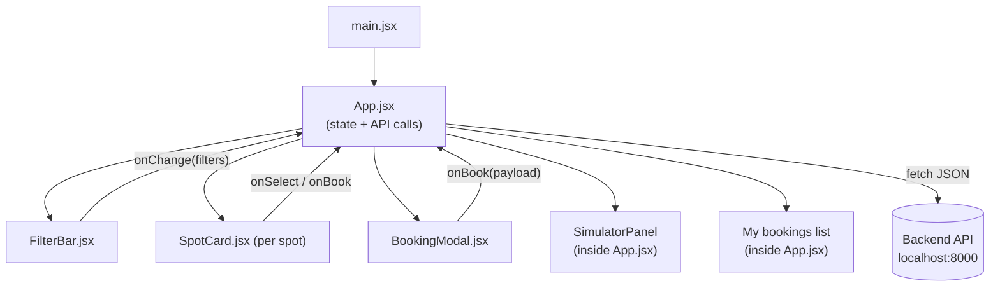
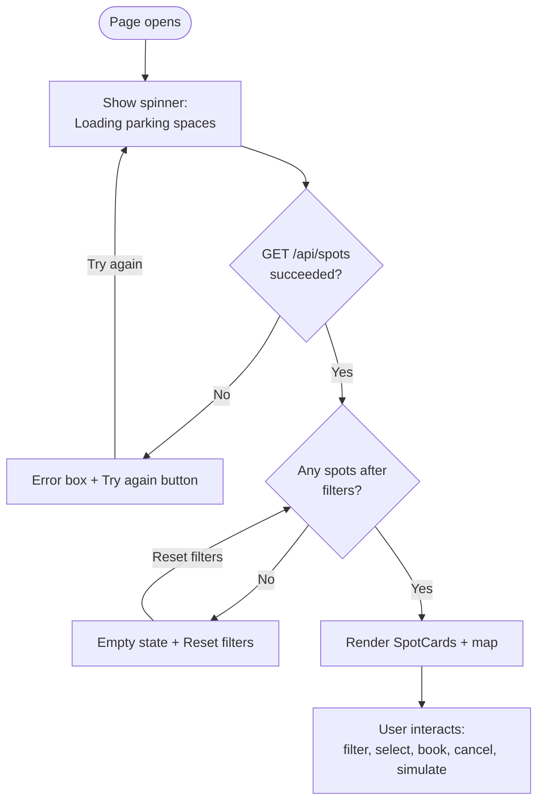
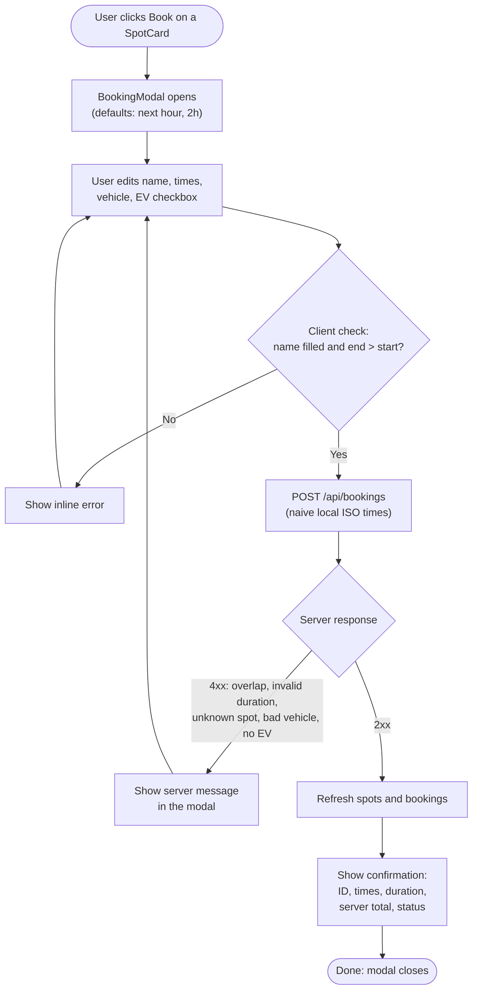
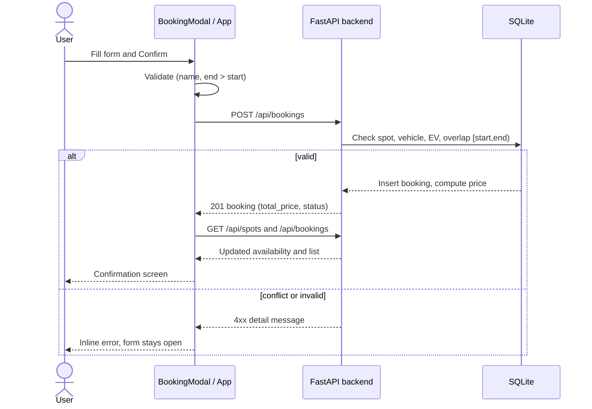
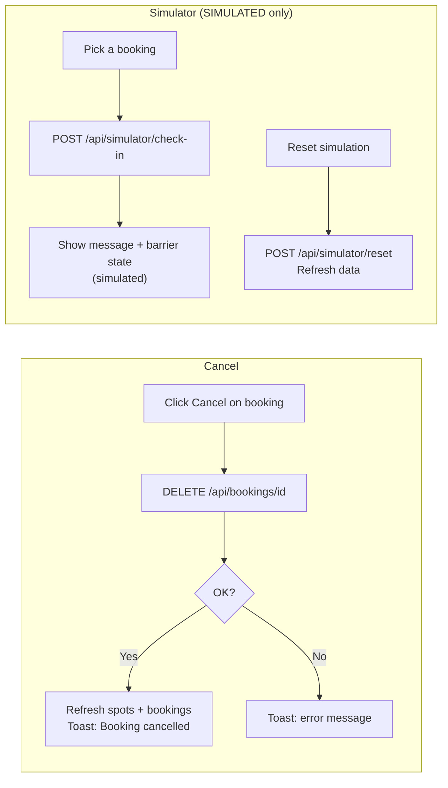
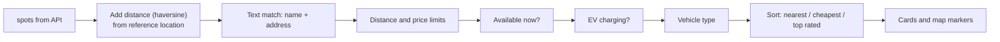
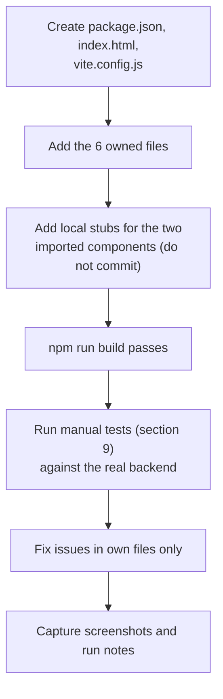

# SpotShare — Member 1 README (Frontend Shell)

> **Owner:** Member 1 (Ashish Kumar) · **Project:** SpotShare — hyperlocal parking & EV charging marketplace · **Format:** 48-hour hackathon

This document covers **only Member 1's work**: responsibilities, requirements, flowcharts, every source file in full, run and test steps, API examples and limitations.

> ⚠️ **Status:** the code below has **not** been executed end-to-end. Run `npm install && npm run build` and the manual tests in section 9 before claiming anything works.

---

## Table of contents

1. [Responsibilities and file ownership](#1-responsibilities-and-file-ownership)
2. [Member 1 requirements](#2-member-1-requirements)
3. [Tech constraints](#3-tech-constraints)
4. [Flowcharts](#4-flowcharts)
5. [Assumptions made in this code](#5-assumptions-made-in-this-code)
6. [Folder structure](#6-folder-structure)
7. [Setup and run](#7-setup-and-run)
8. [Source code](#8-source-code)
9. [Manual test steps](#9-manual-test-steps)
10. [Expected API request/response examples](#10-expected-api-requestresponse-examples)
11. [Known limitations](#11-known-limitations)
12. [Member 1 task checklist](#12-member-1-task-checklist)

---
## 1. Responsibilities and file ownership

Member 1 owns the **frontend shell**: page layout, search and filters, spot cards, the booking modal, the bookings list, the simulator panel, and all loading, empty, success and error states.

| File | Purpose |
|---|---|
| `frontend/src/App.jsx` | Root component: state, API calls, filtering/sorting, layout, bookings list, simulator panel |
| `frontend/src/main.jsx` | React entry point |
| `frontend/src/styles.css` | All styling (plain CSS, responsive, dark theme) |
| `frontend/src/components/SpotCard.jsx` | One parking listing card |
| `frontend/src/components/BookingModal.jsx` | Booking form, price estimate, confirmation |
| `frontend/src/components/FilterBar.jsx` | Search, sliders, toggles, sort |

**Extra config files I propose adding** (not assigned to anyone in the spec): `frontend/package.json`, `frontend/index.html`, `frontend/vite.config.js`.

**Rule:** edit only your own files. Coordinate before changing any shared file.

---

## 2. Member 1 requirements

| # | Requirement (from the project spec) | What Member 1 delivers |
|---|---|---|
| 1 | Visually impressive, responsive marketplace | Dark theme, cards, gradients, responsive layout down to about 375px |
| 2 | Search and filter by location, distance, price, availability, EV | `FilterBar` plus client-side filtering and sorting in `App.jsx` |
| 4 | Listings with coordinates, hourly prices, availability, charging | `SpotCard` (price, distance, status, free spaces, EV kW, amenities) |
| 5 | Booking flow: start/end time, price, cancellation | `BookingModal` (with price estimate), confirmation screen, cancel button in "My bookings" |
| 7 | Occupancy simulator, clearly labelled as simulated | Simulator panel with a **SIMULATED** badge, simulated barrier, check-in and reset buttons |
| 10 | Clear loading, empty, success and error states | Spinner, error box with retry, empty state with reset, success confirmation, toasts, inline errors |

**Rules from the spec that apply to Member 1**
- The backend is authoritative for availability, price and booking conflicts. The frontend only gives a price *estimate* and never relies on its own validation alone.
- Use consistent ISO 8601 timestamps, and document the timezone convention.
- Treat intervals as `[start, end)`.
- Use snake_case field names in all JSON.
- Generate complete, executable code with error handling, run commands, test steps and known limitations.
- Never claim a feature works without testing it.

---

## 3. Tech constraints

React · Vite · JavaScript · **plain CSS** · Fetch API with JSON · snake_case JSON fields.
**Not allowed without approval:** any other framework, CSS framework, auth provider, paid API, or unnecessary dependency.

**Timezone convention:** all timestamps are naive local time (Asia/Kolkata), ISO 8601 with no offset, e.g. `2026-10-29T10:00:00`. Intervals are `[start, end)`: a booking ending at 12:00 does not conflict with one starting at 12:00.


---

## 4. Flowcharts

### 4.1 Component architecture and data flow



### 4.2 Page load and UI states



### 4.3 Booking flow (frontend + backend)



### 4.4 Booking sequence



### 4.5 Cancellation and simulator flow



### 4.6 Filter and sort pipeline



### 4.7 Member 1 work plan




---

## 5. Assumptions made in this code

The spec leaves these details open, so my code assumes the following. If the real API differs, only the Member 1 files listed need to change.

| Area | Assumption | Where it lives |
|---|---|---|
| Timestamps | Naive local time (Asia/Kolkata), ISO 8601 with no offset, e.g. `2026-10-29T10:00:00` | `BookingModal.jsx` (`toApiTime`) |
| Spot list | `GET /api/spots` returns an array (or `{ "spots": [...] }`) of spot objects as in the spec | `App.jsx` (`asList`) |
| Booking response | Has `id` or `booking_id`, `spot_id`, `start_time`, `end_time`, `total_price`, `status`, and optionally `duration_hours` | `App.jsx` (`normalizeBooking`) |
| Error format | `{ "detail": "..." }` (FastAPI default), or a 422 list of `{ loc, msg }` | `App.jsx` (`extractError`) |
| Booking status values | `confirmed` and `cancelled` | `App.jsx` |
| Simulator check-in | Request body `{ "booking_id", "spot_id" }`. The response may contain `message`, `status` and `barrier_state`. | `App.jsx` (`SimulatorPanel`, `handleCheckIn`) |
| Filtering | Done client-side. No query parameters are sent to `GET /api/spots`. | `App.jsx` (`visibleSpots`) |
| Distance | Straight-line (haversine) from a demo reference point or browser location | `App.jsx` |
| Imported components | `App.jsx` imports `ParkingMap` and `SmartInsights` from `./components/`, as default exports | `App.jsx` (top and `<aside>`) |

---

## 6. Folder structure

Files Member 1 creates (marked ✱ are the proposed config files):

```text
frontend/
├── index.html                      ✱
├── package.json                    ✱
├── vite.config.js                  ✱
└── src/
    ├── main.jsx
    ├── App.jsx
    ├── styles.css
    └── components/
        ├── SpotCard.jsx
        ├── BookingModal.jsx
        └── FilterBar.jsx
```

---

## 7. Setup and run

**Dependencies:** `react`, `react-dom`, `leaflet` (runtime); `vite`, `@vitejs/plugin-react` (dev). Nothing else.

```bash
cd frontend
npm install
npm run dev        # http://localhost:5173
npm run build      # must pass before pushing
npm run preview    # serve the production build
```

The API base URL defaults to `http://localhost:8000`. To override it, create `frontend/.env`:

```env
VITE_API_BASE_URL=http://localhost:8000
```

**Local stubs.** `App.jsx` imports `ParkingMap` and `SmartInsights`, which are not Member 1 files. Until they exist in the repo, the build fails. Create these throwaway stubs locally and **do not commit them**:

```jsx
// frontend/src/components/ParkingMap.jsx (LOCAL STUB)
export default function ParkingMap() { return <div style={{ padding: 16 }}>map stub</div> }
```

```jsx
// frontend/src/components/SmartInsights.jsx (LOCAL STUB)
export default function SmartInsights() { return null }
```

---

## 8. Source code

### 8.1 `frontend/package.json` (proposed)

```json
{
  "name": "spotshare-frontend",
  "private": true,
  "version": "0.1.0",
  "type": "module",
  "scripts": {
    "dev": "vite --host 0.0.0.0 --port 5173",
    "build": "vite build",
    "preview": "vite preview --host 0.0.0.0 --port 5173"
  },
  "dependencies": {
    "leaflet": "^1.9.4",
    "react": "^18.3.1",
    "react-dom": "^18.3.1"
  },
  "devDependencies": {
    "@vitejs/plugin-react": "^4.3.4",
    "vite": "^5.4.11"
  }
}
```

### 8.2 `frontend/vite.config.js` (proposed)

```js
import { defineConfig } from 'vite'
import react from '@vitejs/plugin-react'

export default defineConfig({
  plugins: [react()],
  server: { host: true, port: 5173 },
})
```

### 8.3 `frontend/index.html` (proposed)

```html
<!doctype html>
<html lang="en">
  <head>
    <meta charset="UTF-8" />
    <meta name="viewport" content="width=device-width, initial-scale=1.0" />
    <meta name="theme-color" content="#0b1220" />
    <title>SpotShare — Parking & EV Charging Marketplace</title>
  </head>
  <body>
    <div id="root"></div>
    <script type="module" src="/src/main.jsx"></script>
  </body>
</html>
```

### 8.4 `frontend/src/main.jsx`

```jsx
import React from 'react'
import { createRoot } from 'react-dom/client'
import 'leaflet/dist/leaflet.css'
import App from './App.jsx'
import './styles.css'

createRoot(document.getElementById('root')).render(
  <React.StrictMode>
    <App />
  </React.StrictMode>
)
```

### 8.5 `frontend/src/App.jsx`

```jsx
import { useCallback, useEffect, useMemo, useState } from 'react'
import FilterBar from './components/FilterBar.jsx'
import SpotCard from './components/SpotCard.jsx'
import BookingModal from './components/BookingModal.jsx'
import ParkingMap from './components/ParkingMap.jsx'
import SmartInsights from './components/SmartInsights.jsx'

/* Timezone convention: all timestamps are naive local time (Asia/Kolkata),
   ISO 8601 without offset, e.g. 2026-10-29T10:00:00. Intervals are [start, end). */

const API_BASE = import.meta.env.VITE_API_BASE_URL || 'http://localhost:8000'

const DEFAULT_LOCATION = {
  latitude: 12.2958,
  longitude: 76.6394,
  label: 'Mysuru centre (demo reference point)',
}

const DEFAULT_FILTERS = {
  query: '',
  maxDistanceKm: 50, // 50 = "any"
  maxPrice: 500, // 500 = "any"
  availableOnly: false,
  evOnly: false,
  vehicleType: 'all',
  sort: 'distance',
}

/* ---------- helpers ---------- */

function extractError(data, status) {
  const d = data?.detail ?? data?.message
  if (typeof d === 'string') return d
  if (Array.isArray(d)) {
    return d.map((e) => `${(e.loc || []).slice(1).join('.')}: ${e.msg}`).join('; ')
  }
  return `Request failed (HTTP ${status})`
}

async function apiRequest(path, { method = 'GET', body } = {}) {
  let res
  try {
    res = await fetch(`${API_BASE}${path}`, {
      method,
      headers: body ? { 'Content-Type': 'application/json' } : undefined,
      body: body ? JSON.stringify(body) : undefined,
    })
  } catch {
    throw new Error(`Cannot reach the server at ${API_BASE}. Is the backend running?`)
  }
  if (res.status === 204) return null
  let data = null
  try {
    data = await res.json()
  } catch {
    /* non-JSON body */
  }
  if (!res.ok) throw new Error(extractError(data, res.status))
  return data
}

const asList = (data, key) =>
  Array.isArray(data) ? data : data?.[key] ?? data?.items ?? []

function haversineKm(lat1, lon1, lat2, lon2) {
  const R = 6371
  const toRad = (d) => (d * Math.PI) / 180
  const dLat = toRad(lat2 - lat1)
  const dLon = toRad(lon2 - lon1)
  const a =
    Math.sin(dLat / 2) ** 2 +
    Math.cos(toRad(lat1)) * Math.cos(toRad(lat2)) * Math.sin(dLon / 2) ** 2
  return 2 * R * Math.asin(Math.sqrt(a))
}

export function formatMoney(n) {
  if (n == null || Number.isNaN(Number(n))) return '—'
  return `₹${Number(n).toFixed(2).replace(/\.00$/, '')}`
}

function formatDateTime(iso) {
  if (!iso) return '—'
  const d = new Date(iso)
  if (Number.isNaN(d.getTime())) return iso
  return d.toLocaleString('en-IN', {
    day: '2-digit',
    month: 'short',
    hour: '2-digit',
    minute: '2-digit',
  })
}

function normalizeBooking(b) {
  const start = b.start_time
  const end = b.end_time
  let hours = b.duration_hours ?? null
  if (hours == null && start && end) {
    const ms = new Date(end) - new Date(start)
    if (!Number.isNaN(ms)) hours = ms / 3600000
  }
  return {
    id: b.id ?? b.booking_id,
    spotId: b.spot_id,
    start,
    end,
    duration: hours != null ? `${+Number(hours).toFixed(2)} h` : '—',
    total: b.total_price,
    status: b.status ?? 'confirmed',
  }
}

/* ---------- simulator panel (clearly labelled as simulated) ---------- */

function SimulatorPanel({ bookings, spotsById, onCheckIn, onReset }) {
  const [bookingId, setBookingId] = useState('')
  const [busy, setBusy] = useState(false)
  const [result, setResult] = useState(null)
  const [error, setError] = useState('')

  const active = bookings.filter((b) => b.status !== 'cancelled')

  useEffect(() => {
    if (!active.find((b) => b.id === bookingId)) setBookingId(active[0]?.id ?? '')
  }, [active, bookingId])

  const run = async (fn) => {
    setBusy(true)
    setError('')
    try {
      setResult(await fn())
    } catch (e) {
      setError(e.message)
    } finally {
      setBusy(false)
    }
  }

  const barrier = String(result?.barrier_state ?? result?.barrier ?? '').toLowerCase()
  const isOpen = barrier.includes('open')

  return (
    <section className="panel" aria-labelledby="sim-title">
      <div className="panel-head">
        <h2 id="sim-title">Occupancy simulator</h2>
        <span className="badge badge-sim">SIMULATED</span>
      </div>
      <p className="muted small">
        Demo only. This does not control any physical parking barrier.
      </p>

      <div className={`barrier ${isOpen ? 'open' : ''}`} aria-label="Simulated barrier">
        <div className="barrier-post" />
        <div className="barrier-arm" />
        <span className="barrier-label">
          Barrier: {barrier ? (isOpen ? 'open (simulated)' : `${barrier} (simulated)`) : 'closed (simulated)'}
        </span>
      </div>

      {active.length === 0 ? (
        <p className="muted small">Make a booking to try a simulated check-in.</p>
      ) : (
        <div className="row">
          <select
            value={bookingId}
            onChange={(e) => setBookingId(e.target.value)}
            aria-label="Booking to check in"
          >
            {active.map((b) => (
              <option key={b.id} value={b.id}>
                {spotsById[b.spotId]?.name ?? b.spotId} · {formatDateTime(b.start)}
              </option>
            ))}
          </select>
          <button
            className="btn btn-primary"
            disabled={busy || !bookingId}
            onClick={() => run(() => onCheckIn(bookingId))}
          >
            Simulate check-in
          </button>
        </div>
      )}
      <button className="btn btn-ghost" disabled={busy} onClick={() => run(onReset)}>
        Reset simulation
      </button>

      {error && <p className="alert alert-error" role="alert">{error}</p>}
      {result && !error && (
        <p className="alert alert-success" role="status">
          {result.message ?? result.status ?? 'Simulator updated.'}
        </p>
      )}
    </section>
  )
}

/* ---------- app ---------- */

export default function App() {
  const [spots, setSpots] = useState([])
  const [bookings, setBookings] = useState([])
  const [loadState, setLoadState] = useState('loading') // loading | ready | error
  const [loadError, setLoadError] = useState('')
  const [apiOk, setApiOk] = useState(null)
  const [filters, setFilters] = useState(DEFAULT_FILTERS)
  const [location, setLocation] = useState(DEFAULT_LOCATION)
  const [selectedId, setSelectedId] = useState(null)
  const [modalSpot, setModalSpot] = useState(null)
  const [toast, setToast] = useState(null)

  const showToast = useCallback((message, kind = 'success') => {
    setToast({ message, kind })
    window.clearTimeout(showToast.t)
    showToast.t = window.setTimeout(() => setToast(null), 4000)
  }, [])

  const loadSpots = useCallback(async (silent = false) => {
    if (!silent) setLoadState('loading')
    try {
      const data = await apiRequest('/api/spots')
      setSpots(asList(data, 'spots'))
      setLoadState('ready')
      setLoadError('')
    } catch (e) {
      if (!silent) setLoadState('error')
      setLoadError(e.message)
    }
  }, [])

  const loadBookings = useCallback(async () => {
    try {
      const data = await apiRequest('/api/bookings')
      setBookings(asList(data, 'bookings').map(normalizeBooking))
    } catch (e) {
      showToast(`Could not load bookings: ${e.message}`, 'error')
    }
  }, [showToast])

  useEffect(() => {
    loadSpots()
    loadBookings()
    apiRequest('/api/health').then(() => setApiOk(true)).catch(() => setApiOk(false))
  }, [loadSpots, loadBookings])

  const spotsById = useMemo(
    () => Object.fromEntries(spots.map((s) => [s.id, s])),
    [spots]
  )

  const visibleSpots = useMemo(() => {
    const q = filters.query.trim().toLowerCase()
    const withDistance = spots.map((s) => ({
      spot: s,
      distanceKm: haversineKm(location.latitude, location.longitude, s.latitude, s.longitude),
    }))
    const filtered = withDistance.filter(({ spot, distanceKm }) => {
      if (q && !`${spot.name} ${spot.address}`.toLowerCase().includes(q)) return false
      if (filters.maxDistanceKm < 50 && distanceKm > filters.maxDistanceKm) return false
      if (filters.maxPrice < 500 && spot.price_per_hour > filters.maxPrice) return false
      if (filters.availableOnly && !(spot.status === 'available' && spot.available_spaces > 0)) return false
      if (filters.evOnly && !spot.ev_charging) return false
      if (filters.vehicleType !== 'all' && !(spot.vehicle_types || []).includes(filters.vehicleType)) return false
      return true
    })
    const sorters = {
      distance: (a, b) => a.distanceKm - b.distanceKm,
      price: (a, b) => a.spot.price_per_hour - b.spot.price_per_hour,
      rating: (a, b) => (b.spot.rating ?? 0) - (a.spot.rating ?? 0),
    }
    return filtered.sort(sorters[filters.sort] || sorters.distance)
  }, [spots, filters, location])

  const selectSpot = useCallback((id) => {
    setSelectedId(id)
    requestAnimationFrame(() =>
      document.getElementById(`spot-card-${id}`)?.scrollIntoView({ behavior: 'smooth', block: 'nearest' })
    )
  }, [])

  const useMyLocation = () => {
    if (!navigator.geolocation) {
      showToast('Geolocation is not supported in this browser.', 'error')
      return
    }
    navigator.geolocation.getCurrentPosition(
      (pos) =>
        setLocation({
          latitude: pos.coords.latitude,
          longitude: pos.coords.longitude,
          label: 'Your current location',
        }),
      () => showToast('Could not get your location. Using the demo reference point.', 'error'),
      { timeout: 8000 }
    )
  }

  const handleBook = async (payload) => {
    const created = await apiRequest('/api/bookings', { method: 'POST', body: payload })
    await Promise.all([loadSpots(true), loadBookings()])
    return normalizeBooking(created)
  }

  const handleCancel = async (id) => {
    try {
      await apiRequest(`/api/bookings/${encodeURIComponent(id)}`, { method: 'DELETE' })
      await Promise.all([loadSpots(true), loadBookings()])
      showToast('Booking cancelled.')
    } catch (e) {
      showToast(`Cancel failed: ${e.message}`, 'error')
    }
  }

  const handleCheckIn = async (bookingId) => {
    const booking = bookings.find((b) => b.id === bookingId)
    const res = await apiRequest('/api/simulator/check-in', {
      method: 'POST',
      body: { booking_id: bookingId, spot_id: booking?.spotId },
    })
    await loadSpots(true)
    return res
  }

  const handleReset = async () => {
    const res = await apiRequest('/api/simulator/reset', { method: 'POST' })
    await Promise.all([loadSpots(true), loadBookings()])
    return res
  }

  return (
    <div className="app">
      <header className="topbar">
        <div className="brand">
          <span className="brand-mark" aria-hidden="true">P</span>
          <div>
            <h1>SpotShare</h1>
            <p>Hyperlocal parking &amp; EV charging</p>
          </div>
        </div>
        <span
          className={`pill ${apiOk === null ? '' : apiOk ? 'pill-ok' : 'pill-bad'}`}
          title={API_BASE}
        >
          {apiOk === null ? 'Checking API…' : apiOk ? 'API online' : 'API offline'}
        </span>
      </header>

      <main className="layout">
        <div className="col-left">
          <FilterBar
            filters={filters}
            onChange={setFilters}
            onReset={() => setFilters(DEFAULT_FILTERS)}
            onUseLocation={useMyLocation}
            locationLabel={location.label}
            resultCount={visibleSpots.length}
            totalCount={spots.length}
          />

          <section aria-live="polite">
            {loadState === 'loading' && (
              <div className="state-box" role="status">
                <div className="spinner" />
                <p>Loading parking spaces…</p>
              </div>
            )}
            {loadState === 'error' && (
              <div className="state-box state-error" role="alert">
                <p><strong>Couldn’t load parking spaces.</strong></p>
                <p className="muted">{loadError}</p>
                <button className="btn btn-primary" onClick={() => loadSpots()}>Try again</button>
              </div>
            )}
            {loadState === 'ready' && visibleSpots.length === 0 && (
              <div className="state-box">
                <p><strong>No spaces match your filters.</strong></p>
                <p className="muted">Try widening the distance or price, or reset the filters.</p>
                <button className="btn btn-ghost" onClick={() => setFilters(DEFAULT_FILTERS)}>
                  Reset filters
                </button>
              </div>
            )}
            {loadState === 'ready' && visibleSpots.length > 0 && (
              <div className="spot-list">
                {visibleSpots.map(({ spot, distanceKm }) => (
                  <SpotCard
                    key={spot.id}
                    spot={spot}
                    distanceKm={distanceKm}
                    selected={spot.id === selectedId}
                    onSelect={() => selectSpot(spot.id)}
                    onBook={() => setModalSpot(spot)}
                  />
                ))}
              </div>
            )}
          </section>
        </div>

        <aside className="col-right">
          <section className="panel map-panel" aria-label="Map">
            <ParkingMap
              spots={visibleSpots.map((v) => v.spot)}
              selectedSpotId={selectedId}
              onSelectSpot={selectSpot}
              userLocation={{ latitude: location.latitude, longitude: location.longitude }}
            />
          </section>

          <SmartInsights
            apiBaseUrl={API_BASE}
            userLocation={{ latitude: location.latitude, longitude: location.longitude }}
            filters={filters}
            onSelectSpot={selectSpot}
          />

          <section className="panel" aria-labelledby="bookings-title">
            <h2 id="bookings-title">My bookings</h2>
            {bookings.length === 0 ? (
              <p className="muted small">No bookings yet. Pick a space and hit “Book”.</p>
            ) : (
              <ul className="booking-list">
                {bookings.map((b) => (
                  <li key={b.id} className={b.status === 'cancelled' ? 'cancelled' : ''}>
                    <div>
                      <strong>{spotsById[b.spotId]?.name ?? b.spotId}</strong>
                      <div className="muted small">
                        {formatDateTime(b.start)} → {formatDateTime(b.end)} · {b.duration}
                      </div>
                      <div className="small">
                        {formatMoney(b.total)} · <span className="status-text">{b.status}</span>
                      </div>
                    </div>
                    {b.status !== 'cancelled' && (
                      <button className="btn btn-danger btn-sm" onClick={() => handleCancel(b.id)}>
                        Cancel
                      </button>
                    )}
                  </li>
                ))}
              </ul>
            )}
          </section>

          <SimulatorPanel
            bookings={bookings}
            spotsById={spotsById}
            onCheckIn={handleCheckIn}
            onReset={handleReset}
          />
        </aside>
      </main>

      {modalSpot && (
        <BookingModal
          spot={modalSpot}
          onClose={() => setModalSpot(null)}
          onBook={handleBook}
          formatMoney={formatMoney}
          formatDateTime={formatDateTime}
        />
      )}

      {toast && (
        <div className={`toast toast-${toast.kind}`} role="status">
          {toast.message}
        </div>
      )}
    </div>
  )
}
```

### 8.6 `frontend/src/components/FilterBar.jsx`

```jsx
export default function FilterBar({
  filters,
  onChange,
  onReset,
  onUseLocation,
  locationLabel,
  resultCount,
  totalCount,
}) {
  const set = (patch) => onChange({ ...filters, ...patch })

  return (
    <section className="panel filter-bar" aria-label="Search and filters">
      <div className="filter-row">
        <input
          type="search"
          className="search"
          placeholder="Search by name or area…"
          value={filters.query}
          onChange={(e) => set({ query: e.target.value })}
          aria-label="Search parking spaces"
        />
        <button type="button" className="btn btn-ghost" onClick={onUseLocation}>
          Use my location
        </button>
      </div>
      <p className="muted small">Distances measured from: {locationLabel}</p>

      <div className="filter-grid">
        <label className="field">
          <span>
            Max distance: {filters.maxDistanceKm >= 50 ? 'Any' : `${filters.maxDistanceKm} km`}
          </span>
          <input
            type="range"
            min="1"
            max="50"
            value={filters.maxDistanceKm}
            onChange={(e) => set({ maxDistanceKm: Number(e.target.value) })}
          />
        </label>

        <label className="field">
          <span>
            Max price: {filters.maxPrice >= 500 ? 'Any' : `₹${filters.maxPrice}/hr`}
          </span>
          <input
            type="range"
            min="10"
            max="500"
            step="10"
            value={filters.maxPrice}
            onChange={(e) => set({ maxPrice: Number(e.target.value) })}
          />
        </label>

        <label className="field">
          <span>Vehicle</span>
          <select value={filters.vehicleType} onChange={(e) => set({ vehicleType: e.target.value })}>
            <option value="all">All vehicles</option>
            <option value="car">Car</option>
            <option value="bike">Bike</option>
            <option value="ev">EV</option>
          </select>
        </label>

        <label className="field">
          <span>Sort by</span>
          <select value={filters.sort} onChange={(e) => set({ sort: e.target.value })}>
            <option value="distance">Nearest</option>
            <option value="price">Cheapest</option>
            <option value="rating">Top rated</option>
          </select>
        </label>
      </div>

      <div className="filter-row filter-foot">
        <label className="check">
          <input
            type="checkbox"
            checked={filters.availableOnly}
            onChange={(e) => set({ availableOnly: e.target.checked })}
          />
          Available now
        </label>
        <label className="check">
          <input
            type="checkbox"
            checked={filters.evOnly}
            onChange={(e) => set({ evOnly: e.target.checked })}
          />
          ⚡ EV charging
        </label>
        <span className="spacer" />
        <span className="muted small">
          {resultCount} of {totalCount} spaces
        </span>
        <button type="button" className="btn btn-link" onClick={onReset}>
          Reset
        </button>
      </div>
    </section>
  )
}
```

### 8.7 `frontend/src/components/SpotCard.jsx`

```jsx
const money = (n) => `₹${Number(n).toFixed(2).replace(/\.00$/, '')}`

export default function SpotCard({ spot, distanceKm, selected, onSelect, onBook }) {
  const capacity = spot.capacity || 0
  const free = Math.max(0, spot.available_spaces ?? 0)
  const pct = capacity > 0 ? Math.min(100, Math.round((free / capacity) * 100)) : 0
  const full = free === 0
  const status = full && spot.status === 'available' ? 'full' : spot.status

  return (
    <article
      id={`spot-card-${spot.id}`}
      className={`card ${selected ? 'card-selected' : ''}`}
      onClick={onSelect}
    >
      <div className="card-top">
        <div>
          <h3>{spot.name}</h3>
          <p className="muted small">{spot.address}</p>
        </div>
        <div className="price">
          <strong>{money(spot.price_per_hour)}</strong>
          <span>/hr</span>
        </div>
      </div>

      <div className="badges">
        <span className={`badge badge-status status-${status}`}>{status}</span>
        {spot.ev_charging && (
          <span className="badge badge-ev">
            ⚡ EV{spot.charger_power_kw ? ` · ${spot.charger_power_kw} kW` : ''}
          </span>
        )}
        {spot.rating != null && <span className="badge">★ {Number(spot.rating).toFixed(1)}</span>}
        <span className="badge">{distanceKm.toFixed(1)} km</span>
        {(spot.vehicle_types || []).map((v) => (
          <span key={v} className="badge badge-soft">{v}</span>
        ))}
      </div>

      <div className="avail">
        <div className="avail-bar" aria-hidden="true">
          <div className={`avail-fill ${full ? 'empty' : pct < 30 ? 'low' : ''}`} style={{ width: `${pct}%` }} />
        </div>
        <span className="small">
          {free} of {capacity} spaces free
        </span>
      </div>

      {(spot.amenities || []).length > 0 && (
        <p className="amenities small muted">{spot.amenities.join(' · ')}</p>
      )}

      <div className="card-actions">
        <button
          type="button"
          className="btn btn-ghost btn-sm"
          onClick={(e) => {
            e.stopPropagation()
            onSelect()
          }}
        >
          View on map
        </button>
        <button
          type="button"
          className="btn btn-primary btn-sm"
          onClick={(e) => {
            e.stopPropagation()
            onBook()
          }}
        >
          Book
        </button>
      </div>
    </article>
  )
}
```

### 8.8 `frontend/src/components/BookingModal.jsx`

```jsx
import { useEffect, useMemo, useState } from 'react'

function pad(n) {
  return String(n).padStart(2, '0')
}
// Local time formatted for <input type="datetime-local">: YYYY-MM-DDTHH:mm
function toLocalInput(d) {
  return `${d.getFullYear()}-${pad(d.getMonth() + 1)}-${pad(d.getDate())}T${pad(d.getHours())}:${pad(d.getMinutes())}`
}
// Naive local ISO 8601 with seconds, as the API expects: YYYY-MM-DDTHH:mm:00
const toApiTime = (v) => (v.length === 16 ? `${v}:00` : v)

function defaultStart() {
  const d = new Date()
  d.setMinutes(0, 0, 0)
  d.setHours(d.getHours() + 1)
  return d
}

export default function BookingModal({ spot, onClose, onBook, formatMoney, formatDateTime }) {
  const start0 = useMemo(defaultStart, [])
  const vehicles = spot.vehicle_types?.length ? spot.vehicle_types : ['car']

  const [name, setName] = useState('Demo User')
  const [start, setStart] = useState(toLocalInput(start0))
  const [end, setEnd] = useState(toLocalInput(new Date(start0.getTime() + 2 * 3600000)))
  const [vehicle, setVehicle] = useState(vehicles[0])
  const [needsEv, setNeedsEv] = useState(false)
  const [busy, setBusy] = useState(false)
  const [error, setError] = useState('')
  const [booking, setBooking] = useState(null)

  useEffect(() => {
    const onKey = (e) => e.key === 'Escape' && onClose()
    window.addEventListener('keydown', onKey)
    return () => window.removeEventListener('keydown', onKey)
  }, [onClose])

  const hours = (new Date(end) - new Date(start)) / 3600000
  const validRange = Number.isFinite(hours) && hours > 0
  const estimate = validRange ? Math.round(hours * spot.price_per_hour * 100) / 100 : null

  const submit = async (e) => {
    e.preventDefault()
    setError('')
    if (!name.trim()) return setError('Please enter your name.')
    if (!validRange) return setError('End time must be after the start time.')
    setBusy(true)
    try {
      const created = await onBook({
        spot_id: spot.id,
        customer_name: name.trim(),
        start_time: toApiTime(start),
        end_time: toApiTime(end),
        vehicle_type: vehicle,
        requires_ev_charging: needsEv,
      })
      setBooking(created)
    } catch (err) {
      setError(err.message)
    } finally {
      setBusy(false)
    }
  }

  return (
    <div className="modal-backdrop" onMouseDown={(e) => e.target === e.currentTarget && onClose()}>
      <div className="modal" role="dialog" aria-modal="true" aria-labelledby="booking-title">
        <button className="modal-close" onClick={onClose} aria-label="Close">×</button>

        {booking ? (
          <div className="modal-success">
            <div className="check-circle" aria-hidden="true">✓</div>
            <h2 id="booking-title">Booking confirmed</h2>
            <dl className="summary">
              <dt>Booking ID</dt><dd>{booking.id}</dd>
              <dt>Space</dt><dd>{spot.name}</dd>
              <dt>From</dt><dd>{formatDateTime(booking.start)}</dd>
              <dt>To</dt><dd>{formatDateTime(booking.end)}</dd>
              <dt>Duration</dt><dd>{booking.duration}</dd>
              <dt>Total (server)</dt><dd><strong>{formatMoney(booking.total)}</strong></dd>
              <dt>Status</dt><dd>{booking.status}</dd>
            </dl>
            <button className="btn btn-primary" onClick={onClose}>Done</button>
          </div>
        ) : (
          <form onSubmit={submit} noValidate>
            <h2 id="booking-title">Book {spot.name}</h2>
            <p className="muted small">{spot.address} · {formatMoney(spot.price_per_hour)}/hr</p>

            <label className="field">
              <span>Your name</span>
              <input value={name} onChange={(e) => setName(e.target.value)} required />
            </label>

            <div className="two-col">
              <label className="field">
                <span>Start</span>
                <input type="datetime-local" value={start} onChange={(e) => setStart(e.target.value)} required />
              </label>
              <label className="field">
                <span>End</span>
                <input type="datetime-local" value={end} onChange={(e) => setEnd(e.target.value)} required />
              </label>
            </div>

            <label className="field">
              <span>Vehicle type</span>
              <select value={vehicle} onChange={(e) => setVehicle(e.target.value)}>
                {vehicles.map((v) => (
                  <option key={v} value={v}>{v}</option>
                ))}
              </select>
            </label>

            <label className={`check ${spot.ev_charging ? '' : 'disabled'}`}>
              <input
                type="checkbox"
                checked={needsEv}
                disabled={!spot.ev_charging}
                onChange={(e) => setNeedsEv(e.target.checked)}
              />
              I need EV charging
              {!spot.ev_charging && <em className="muted small"> (not available here)</em>}
            </label>

            <div className="estimate">
              <span>Estimated total</span>
              <strong>{estimate != null ? formatMoney(estimate) : '—'}</strong>
            </div>
            <p className="muted small">
              Estimate only. The server calculates the final price and checks for conflicts.
              Times are local (Asia/Kolkata); a booking ending at 12:00 doesn’t clash with one starting at 12:00.
            </p>

            {error && <p className="alert alert-error" role="alert">{error}</p>}

            <div className="modal-actions">
              <button type="button" className="btn btn-ghost" onClick={onClose}>Cancel</button>
              <button type="submit" className="btn btn-primary" disabled={busy}>
                {busy ? 'Booking…' : 'Confirm booking'}
              </button>
            </div>
          </form>
        )}
      </div>
    </div>
  )
}
```

### 8.9 `frontend/src/styles.css`

```css
:root {
  --bg: #0b1220;
  --bg-2: #111a2e;
  --panel: #151f36;
  --panel-2: #1b2744;
  --border: #26345a;
  --text: #e8ecf6;
  --muted: #8f9bb8;
  --primary: #4f8cff;
  --primary-2: #7a5cff;
  --ok: #2ecc8f;
  --warn: #f5a524;
  --bad: #ff5d6c;
  --ev: #22d3a6;
  --radius: 14px;
  font-family: Inter, system-ui, -apple-system, 'Segoe UI', Roboto, sans-serif;
  color-scheme: dark;
}

* { box-sizing: border-box; }
body {
  margin: 0;
  background: radial-gradient(1200px 600px at 10% -10%, #1a2a55 0%, transparent 60%),
              radial-gradient(900px 500px at 100% 0%, #2a1a55 0%, transparent 55%), var(--bg);
  color: var(--text);
  min-height: 100vh;
}
h1, h2, h3, p { margin: 0; }
h2 { font-size: 1.05rem; margin-bottom: 0.6rem; }
h3 { font-size: 1.05rem; }
.muted { color: var(--muted); }
.small { font-size: 0.82rem; }
.spacer { flex: 1; }

/* top bar */
.topbar {
  display: flex; align-items: center; justify-content: space-between;
  padding: 14px clamp(14px, 3vw, 32px);
  border-bottom: 1px solid var(--border);
  background: rgba(11, 18, 32, 0.8); backdrop-filter: blur(10px);
  position: sticky; top: 0; z-index: 50;
}
.brand { display: flex; gap: 12px; align-items: center; }
.brand h1 { font-size: 1.25rem; letter-spacing: 0.2px; }
.brand p { font-size: 0.78rem; color: var(--muted); }
.brand-mark {
  width: 40px; height: 40px; border-radius: 12px; display: grid; place-items: center;
  font-weight: 800; background: linear-gradient(135deg, var(--primary), var(--primary-2));
  box-shadow: 0 6px 20px rgba(79, 140, 255, 0.4);
}
.pill {
  font-size: 0.78rem; padding: 5px 12px; border-radius: 999px;
  background: var(--panel); border: 1px solid var(--border); color: var(--muted);
}
.pill-ok { color: var(--ok); border-color: rgba(46, 204, 143, 0.4); }
.pill-bad { color: var(--bad); border-color: rgba(255, 93, 108, 0.4); }

/* layout */
.layout {
  display: grid; grid-template-columns: minmax(0, 1.05fr) minmax(0, 1fr);
  gap: 20px; padding: 20px clamp(14px, 3vw, 32px); max-width: 1500px; margin: 0 auto;
}
.col-left, .col-right { display: flex; flex-direction: column; gap: 16px; min-width: 0; }
.col-right { position: sticky; top: 84px; align-self: start; max-height: calc(100vh - 100px); overflow-y: auto; padding-right: 4px; }

.panel {
  background: linear-gradient(180deg, var(--panel), var(--bg-2));
  border: 1px solid var(--border); border-radius: var(--radius); padding: 16px;
}
.panel-head { display: flex; justify-content: space-between; align-items: center; }
.map-panel { padding: 0; overflow: hidden; min-height: 340px; }
.map-panel > * { min-height: 340px; }

/* controls */
input, select, button { font: inherit; }
input[type='search'], input[type='text'], input:not([type]), input[type='datetime-local'], select {
  width: 100%; background: var(--bg); color: var(--text);
  border: 1px solid var(--border); border-radius: 10px; padding: 9px 12px;
}
input:focus, select:focus, button:focus-visible { outline: 2px solid var(--primary); outline-offset: 1px; }
input[type='range'] { width: 100%; accent-color: var(--primary); }
.field { display: flex; flex-direction: column; gap: 6px; font-size: 0.85rem; margin-bottom: 12px; }
.field > span { color: var(--muted); }
.check { display: inline-flex; align-items: center; gap: 8px; font-size: 0.9rem; cursor: pointer; }
.check.disabled { opacity: 0.55; cursor: not-allowed; }
.row { display: flex; gap: 8px; margin: 10px 0; }

.btn {
  border: 1px solid transparent; border-radius: 10px; padding: 9px 16px; cursor: pointer;
  font-weight: 600; transition: transform 0.12s, box-shadow 0.12s, background 0.12s;
  color: var(--text); background: var(--panel-2);
}
.btn:hover:not(:disabled) { transform: translateY(-1px); }
.btn:disabled { opacity: 0.5; cursor: not-allowed; }
.btn-primary { background: linear-gradient(135deg, var(--primary), var(--primary-2)); box-shadow: 0 6px 18px rgba(79, 140, 255, 0.3); }
.btn-ghost { background: transparent; border-color: var(--border); }
.btn-danger { background: rgba(255, 93, 108, 0.15); color: var(--bad); border-color: rgba(255, 93, 108, 0.4); }
.btn-link { background: none; color: var(--primary); padding: 4px 6px; }
.btn-sm { padding: 6px 12px; font-size: 0.85rem; }

/* filters */
.filter-bar { display: flex; flex-direction: column; gap: 10px; }
.filter-row { display: flex; gap: 10px; align-items: center; flex-wrap: wrap; }
.filter-row .search { flex: 1; min-width: 180px; }
.filter-grid { display: grid; grid-template-columns: repeat(2, minmax(0, 1fr)); gap: 4px 16px; }
.filter-grid .field { margin-bottom: 4px; }
.filter-foot { border-top: 1px solid var(--border); padding-top: 10px; }

/* spot cards */
.spot-list { display: grid; gap: 12px; }
.card {
  background: linear-gradient(180deg, var(--panel), var(--bg-2));
  border: 1px solid var(--border); border-radius: var(--radius); padding: 16px;
  cursor: pointer; transition: border-color 0.15s, transform 0.15s, box-shadow 0.15s;
}
.card:hover { transform: translateY(-2px); border-color: #3a4d85; }
.card-selected { border-color: var(--primary); box-shadow: 0 0 0 1px var(--primary), 0 10px 30px rgba(79, 140, 255, 0.2); }
.card-top { display: flex; justify-content: space-between; gap: 12px; }
.price { text-align: right; white-space: nowrap; }
.price strong { font-size: 1.35rem; }
.price span { color: var(--muted); font-size: 0.8rem; }
.badges { display: flex; flex-wrap: wrap; gap: 6px; margin: 12px 0; }
.badge {
  font-size: 0.74rem; padding: 3px 9px; border-radius: 999px;
  background: var(--panel-2); border: 1px solid var(--border); text-transform: capitalize;
}
.badge-soft { background: transparent; color: var(--muted); }
.badge-ev { color: var(--ev); border-color: rgba(34, 211, 166, 0.45); background: rgba(34, 211, 166, 0.08); }
.badge-sim { color: var(--warn); border-color: rgba(245, 165, 36, 0.5); background: rgba(245, 165, 36, 0.1); letter-spacing: 1px; font-weight: 700; }
.status-available { color: var(--ok); border-color: rgba(46, 204, 143, 0.45); }
.status-full, .status-unavailable, .status-occupied { color: var(--bad); border-color: rgba(255, 93, 108, 0.45); }
.status-reserved { color: var(--warn); border-color: rgba(245, 165, 36, 0.45); }
.avail { display: flex; align-items: center; gap: 10px; }
.avail-bar { flex: 1; height: 7px; border-radius: 99px; background: var(--bg); overflow: hidden; }
.avail-fill { height: 100%; background: var(--ok); border-radius: 99px; transition: width 0.3s; }
.avail-fill.low { background: var(--warn); }
.avail-fill.empty { background: var(--bad); }
.amenities { margin-top: 8px; }
.card-actions { display: flex; justify-content: flex-end; gap: 8px; margin-top: 12px; }

/* states */
.state-box {
  text-align: center; padding: 36px 16px; border: 1px dashed var(--border);
  border-radius: var(--radius); display: grid; gap: 8px; justify-items: center;
}
.state-error { border-color: rgba(255, 93, 108, 0.5); }
.spinner {
  width: 30px; height: 30px; border-radius: 50%;
  border: 3px solid var(--border); border-top-color: var(--primary); animation: spin 0.8s linear infinite;
}
@keyframes spin { to { transform: rotate(360deg); } }
.alert { padding: 9px 12px; border-radius: 10px; font-size: 0.88rem; margin-top: 10px; }
.alert-error { background: rgba(255, 93, 108, 0.12); color: #ff9aa4; border: 1px solid rgba(255, 93, 108, 0.4); }
.alert-success { background: rgba(46, 204, 143, 0.12); color: #7ee8bd; border: 1px solid rgba(46, 204, 143, 0.4); }

/* bookings */
.booking-list { list-style: none; margin: 0; padding: 0; display: grid; gap: 10px; }
.booking-list li {
  display: flex; justify-content: space-between; gap: 10px; align-items: center;
  background: var(--bg); border: 1px solid var(--border); border-radius: 10px; padding: 10px 12px;
}
.booking-list li.cancelled { opacity: 0.5; }
.status-text { text-transform: capitalize; color: var(--muted); }

/* simulator */
.barrier { position: relative; height: 70px; margin: 12px 0; border-radius: 10px; background: var(--bg); border: 1px solid var(--border); overflow: hidden; }
.barrier-post { position: absolute; left: 20px; bottom: 12px; width: 14px; height: 40px; background: #3a4d85; border-radius: 4px; }
.barrier-arm {
  position: absolute; left: 27px; bottom: 44px; width: 62%; height: 8px; border-radius: 4px;
  background: repeating-linear-gradient(90deg, var(--bad) 0 16px, #fff 16px 32px);
  transform-origin: left center; transition: transform 0.6s ease;
}
.barrier.open .barrier-arm { transform: rotate(-70deg); }
.barrier-label { position: absolute; right: 10px; bottom: 6px; font-size: 0.74rem; color: var(--muted); }

/* modal */
.modal-backdrop {
  position: fixed; inset: 0; background: rgba(4, 8, 18, 0.7); backdrop-filter: blur(4px);
  display: grid; place-items: center; padding: 16px; z-index: 1000; overflow-y: auto;
}
.modal {
  position: relative; width: min(480px, 100%); background: var(--panel);
  border: 1px solid var(--border); border-radius: 18px; padding: 24px;
  box-shadow: 0 30px 80px rgba(0, 0, 0, 0.5);
}
.modal h2 { font-size: 1.25rem; margin-bottom: 4px; }
.modal-close { position: absolute; top: 10px; right: 14px; background: none; border: none; color: var(--muted); font-size: 1.6rem; cursor: pointer; }
.two-col { display: grid; grid-template-columns: 1fr 1fr; gap: 12px; }
.estimate { display: flex; justify-content: space-between; align-items: center; margin: 12px 0 6px; padding: 12px; background: var(--bg); border-radius: 10px; }
.estimate strong { font-size: 1.3rem; }
.modal-actions { display: flex; justify-content: flex-end; gap: 10px; margin-top: 16px; }
.modal-success { text-align: center; display: grid; gap: 14px; justify-items: center; }
.check-circle { width: 56px; height: 56px; border-radius: 50%; display: grid; place-items: center; font-size: 1.8rem; background: rgba(46, 204, 143, 0.15); color: var(--ok); }
.summary { display: grid; grid-template-columns: auto 1fr; gap: 6px 16px; text-align: left; width: 100%; margin: 0; }
.summary dt { color: var(--muted); }
.summary dd { margin: 0; text-align: right; word-break: break-all; }

/* toast */
.toast {
  position: fixed; bottom: 20px; left: 50%; transform: translateX(-50%); z-index: 2000;
  padding: 11px 20px; border-radius: 12px; font-size: 0.92rem; max-width: 90vw;
  background: var(--panel-2); border: 1px solid var(--border); box-shadow: 0 10px 30px rgba(0, 0, 0, 0.4);
}
.toast-success { border-color: rgba(46, 204, 143, 0.6); }
.toast-error { border-color: rgba(255, 93, 108, 0.6); }

/* responsive */
@media (max-width: 980px) {
  .layout { grid-template-columns: 1fr; }
  .col-right { position: static; max-height: none; overflow: visible; padding-right: 0; }
  .map-panel, .map-panel > * { min-height: 300px; }
}
@media (max-width: 520px) {
  .filter-grid, .two-col { grid-template-columns: 1fr; }
  .brand p { display: none; }
}
@media (prefers-reduced-motion: reduce) {
  * { transition: none !important; animation: none !important; }
}
```


---

## 9. Manual test steps

| # | Test | Expected result |
|---|---|---|
| 1 | Start backend, then frontend | Spinner, then spot cards. Header pill shows **API online**. |
| 2 | Stop backend, reload | Error box with **Try again**. After restarting the backend, Try again loads the spots. |
| 3 | Type "campus", toggle EV, drag sliders | Result count updates. Impossible filters show the empty state with **Reset filters**. |
| 4 | Click a card | The card highlights (and the selected id is passed to the map component). |
| 5 | Book 10:00–12:00 on a spot | Confirmation shows booking ID, duration and the **server** total. The free-space count updates. |
| 6 | Book 12:00–13:00 on the same spot | Succeeds, because intervals are `[start, end)`. |
| 7 | Book 11:00–13:00 on the same spot | Rejected. The server message appears inside the modal. |
| 8 | End before start | The modal shows "End time must be after the start time." |
| 9 | Bike on a car-only spot; EV on a non-EV spot | EV checkbox is disabled in the UI. Verify the backend rejection with `curl`. |
| 10 | Cancel from **My bookings** | Status changes to cancelled and availability is restored. |
| 11 | Simulate check-in, then reset | The panel is labelled **SIMULATED** and the barrier animation reflects the response. |
| 12 | Resize to about 375px wide | No horizontal scroll. The modal scrolls and the layout stacks. |
| 13 | `npm run build` | Succeeds with no errors. |


---

## 10. Expected API request/response examples

**Create booking**

```http
POST /api/bookings
Content-Type: application/json

{
  "spot_id": "spot101",
  "customer_name": "Demo User",
  "start_time": "2026-10-29T10:00:00",
  "end_time": "2026-10-29T12:00:00",
  "vehicle_type": "car",
  "requires_ev_charging": false
}
```

```json
201 Created
{
  "id": "bk_1",
  "spot_id": "spot101",
  "start_time": "2026-10-29T10:00:00",
  "end_time": "2026-10-29T12:00:00",
  "duration_hours": 2,
  "total_price": 60,
  "status": "confirmed"
}
```

**Overlap or invalid request** (shown inline in the modal)

```json
409 or 422
{ "detail": "Time slot overlaps an existing booking" }
```

**List spots:** `GET /api/spots` returns `[ { ...spot object from the spec... } ]` (a `{ "spots": [...] }` wrapper is also accepted).

**Cancel:** `DELETE /api/bookings/bk_1` returns 200 or 204.

**Simulator (assumed, see section 5)**

```http
POST /api/simulator/check-in
{ "booking_id": "bk_1", "spot_id": "spot101" }
```

```json
200
{ "message": "Simulated check-in complete", "status": "occupied", "barrier_state": "open" }
```


---

## 11. Known limitations

- The code has not been run end-to-end. Everything above must be verified.
- Filtering is client-side. "Available now" reflects current `available_spaces`, not availability for a chosen future window.
- Distance is straight-line (haversine) from a demo reference point or browser geolocation, not road distance.
- The modal price is only an estimate. The backend is authoritative for price and conflicts.
- The simulator request and response shapes are assumptions (see section 5).
- No pagination for bookings and no authentication (per the no-auth-provider rule). The customer is just a typed name.
- Geolocation works only on HTTPS or localhost.
- The simulator is purely simulated and does not control any physical barrier.


---

## 12. Member 1 task checklist

- [ ] Add the six owned files (and the three config files)
- [ ] Create the local stubs (do not commit them)
- [ ] `npm install` and `npm run build` pass
- [ ] Run all manual tests in section 9 against the real backend
- [ ] Check the page at about 375px width (no horizontal scroll)
- [ ] Fix issues in your own files only
- [ ] Capture screenshots and write run notes
